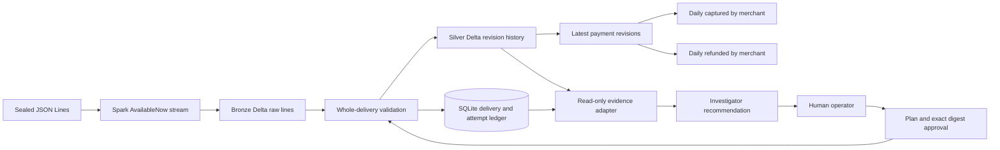

# Architecture

The project simulates a producer delivery and the on-call work that follows a failure. Each demo runs in its own namespace. Every payment and operator identity in a demo is fictional.

## Data and contracts

- Bronze contains the input line, source path and delivery ID. The original file checksum and an order-independent multiset of line checksums let the projector verify both the file and the Spark capture. Sorting hashes preserves repeated lines in that comparison.
- Silver contains one accepted row per payment ID and revision. Every accepted version of a payment keeps its original merchant and business date. A newer revision replaces the previous revision in the serving view, including when the new status is `REFUNDED`.
- Amounts arrive as canonical decimal strings and are stored in Spark as `DECIMAL(18,2)`. Report totals are decimal strings. The source carries a UTC event timestamp and a separate producer-supplied business date.
- Producer version 2 adds the optional `channel` field. Silver has included a nullable channel since its initial schema. A version 2 row without a channel has the same business hash as the equivalent version 1 row. The CI contract check compares field definitions and replays frozen valid and invalid examples.

## Investigation and replay

The investigator can look up one delivery and request the committed lineage graph. It sees bounded structured observations with stable evidence IDs. It receives no raw Bronze records. A diagnosis needs matching status and findings as well as the required lineage. A replay suggestion also needs a validated recovery preview.

An operator approves the exact digest of a stored replay plan. The plan binds the delivery, seal, Silver version, contract, lineage and candidate rows. The application checks the plan again under the writer lock. The two serving views can keep reading the most recent accepted revisions during a delivery failure.

The report lists possible downstream impact separately from the delivery status. Lineage tells the reader where a missing delivery could matter. The ledger tells the reader whether the delivery reached Silver.

## Scope and next steps

- Run this version with one local JVM at a time and one writable named volume. SQLite holds the operational records. Delta holds the committed payment history.
- A production rollout would need authenticated operator identities, monitoring for stuck attempts and an agreed retention policy. The local actor ID records who asserted approval in the demo.
- A larger pipeline would use durable object storage, a shared state database and coordinated writer ownership. Compare that design against the recovery assumptions before adopting it. The [recovery decision](decisions/002-recovery-boundary.md) describes the boundary.
- The scripted evaluation covers authored scenarios. Use a separate challenge set and repeated live runs before making claims about model quality.
